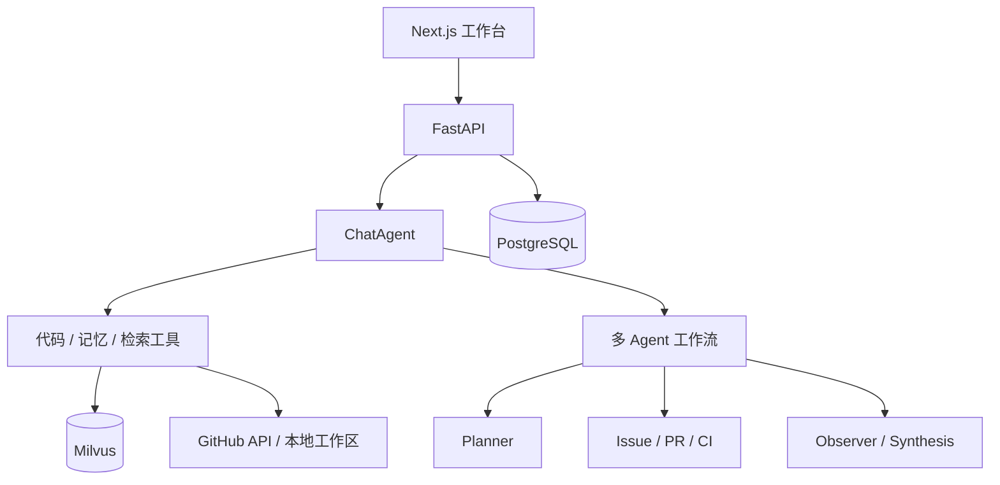

# RepoScope

面向 GitHub 研发协作的多 Agent 工作台，连接 Issue、PR、CI、项目文档与本地代码，为问题分诊、代码审查和故障排查提供带证据的分析建议。

## 核心设计

- **多 Agent 编排**：专用分析能力分别处理 Issue、PR 和 CI；复杂任务通过 Planner、程序调度器 Orchestrator、Observer 和 Synthesis 组织计划、执行、复核与汇总，并限制补充规划次数。
- **上下文工程**：区分原始消息、活动输入和工作记忆，按预算组织工具结果，必要时压缩历史并保存 Boundary、保留消息编号与恢复入口。
- **按来源取证**：当前代码走工作区读取和词法搜索，研发状态查询数据库/API，历史讨论和文档进入 RAG。
- **受控操作与运行追踪**：外部写入先生成 ActionDraft，再经权限检查与人工批准；SSE 展示工具和任务状态，数据库保存运行记录。
- **评测与回归**：包含工具调用、结构化输出、检索、记忆、工作流和安全边界测试，并提供 RAGAS 评测接口。

## 技术栈

| 层次 | 技术 |
| --- | --- |
| 后端 | Python、FastAPI、Pydantic、SQLAlchemy、LangChain、LangGraph |
| 前端 | Next.js、React、TypeScript、Tailwind CSS、React Query |
| 存储与检索 | PostgreSQL、Milvus、Embedding、关键词匹配、Rerank |
| 工具与交互 | GitHub REST API、MCP、SSE |
| 本地服务 | Docker Compose、etcd、MinIO |



## 本地启动

需要 Python、Node.js/npm 和可用的 Docker 环境。默认使用本地 Qwen Embedding，首次启动需准备模型与依赖；也可通过环境配置切换模型服务。

### 配置环境与基础服务

```bash
cp .env.example .env
docker compose up -d postgres etcd minio milvus
```

在 `.env` 配置聊天模型的 `LLM_API_KEY`、`LLM_BASE_URL`、`LLM_MODEL`；使用远程仓库同步时，配置所需最小权限的 GitHub Token。

默认数据库、向量集合、容器与数据卷使用 `reposcope` 标识。

### 后端（macOS / Linux）

```bash
cd backend
python3 -m venv .venv
source .venv/bin/activate
python -m pip install -r requirements.txt
# 使用默认本地 Embedding 时安装：
python -m pip install -r requirements-local-embedding.txt
uvicorn app.main:app --reload
```

Windows 使用 `.venv\Scripts\activate` 激活虚拟环境。另有 `scripts/start_rag.ps1` 演示脚本，其降级检索不代表完整向量链路已经验证。

### 前端

在项目根目录另开终端：

```bash
cd frontend
npm ci
npm run dev
```

- 工作台：<http://localhost:3000>
- 后端：<http://localhost:8000>
- API 文档：<http://localhost:8000/docs>

## 目录

```text
backend/app/
  api/routes/             HTTP 与 SSE 接口
  services/agents/        对话、专用 Agent 与工作流
  services/chat_memory.py
  services/context_compression.py
  services/rag/           文档、向量与检索
  skills/                 可复用任务指令
  mcp/                    记忆工具服务
  tests/                  后端测试
frontend/                 交互工作台
docs/                     架构、API 与示例
scripts/                  同步、演示启动与辅助脚本
```

## 使用与验证

连接仓库或配置工作区后，可进行 Issue 分析、PR 审查和 CI 诊断；复杂任务可预览计划再确认执行。写操作需要检查草稿目标、内容和权限。

安装后端依赖后，从 `backend` 目录运行：

```bash
python -m pytest app/tests
```

模型、向量检索和 GitHub 集成测试需要对应环境。仓库包含测试和评测代码，本文不报告未经本次实际运行确认的通过率、性能或线上结果。

## 当前边界

项目为研发协作应用原型，生产部署需按环境补齐登录与租户隔离、任务恢复和运维观测。文本裁剪和记忆封存不保证所有工具原文均完整保存，原文恢复能力应核对具体工具的来源与存储路径。

实际密钥、运行日志、本地数据库、依赖目录和构建产物由 `.gitignore` 排除。
